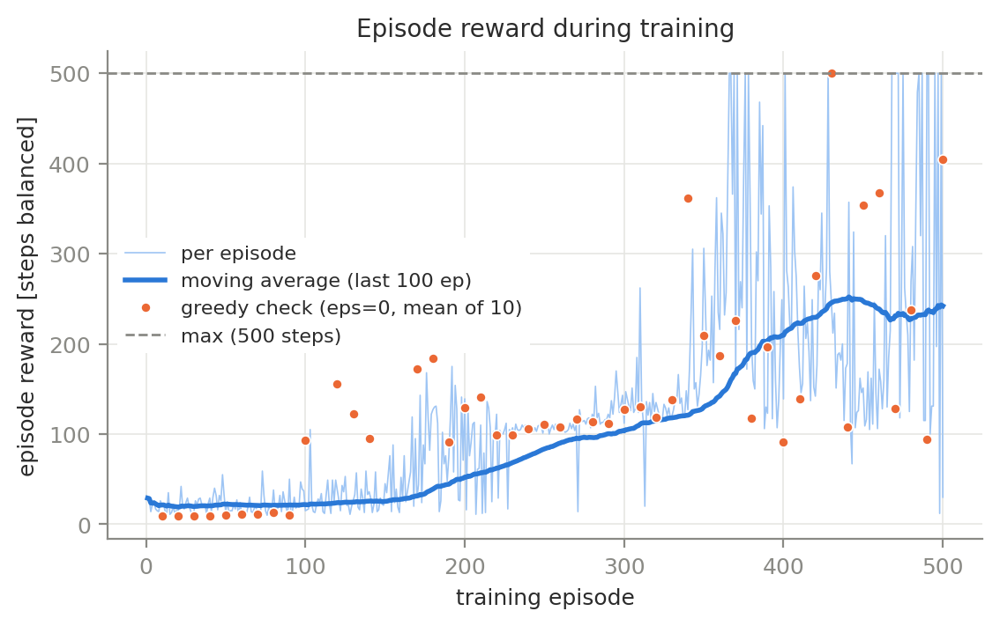
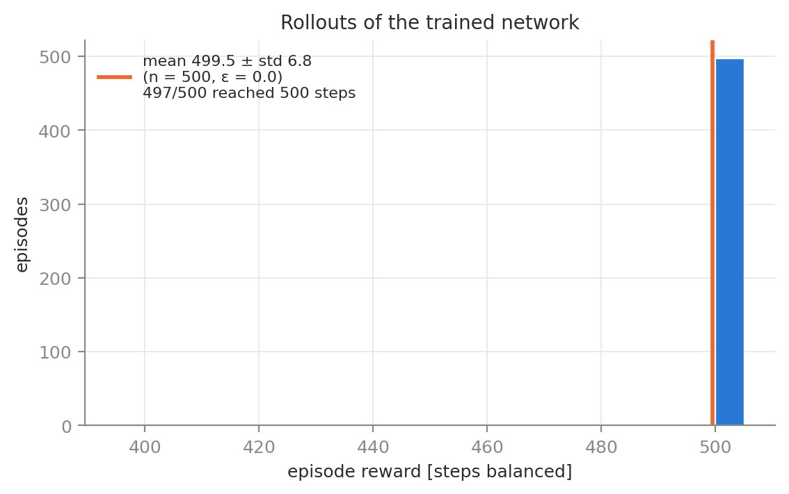
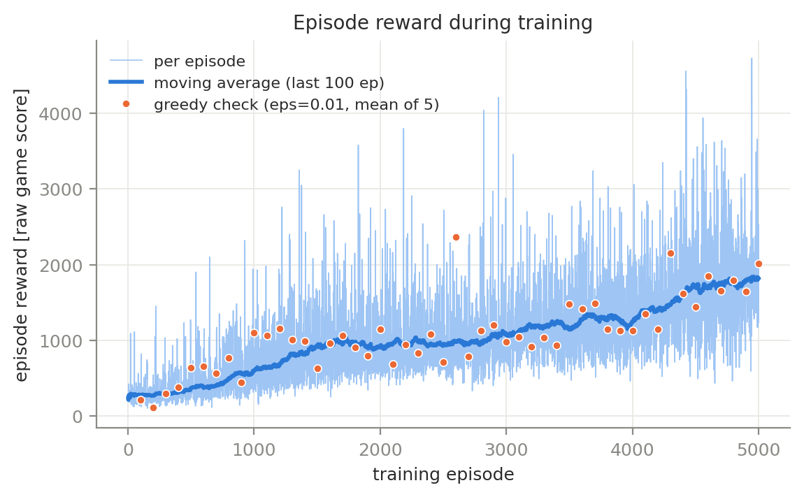
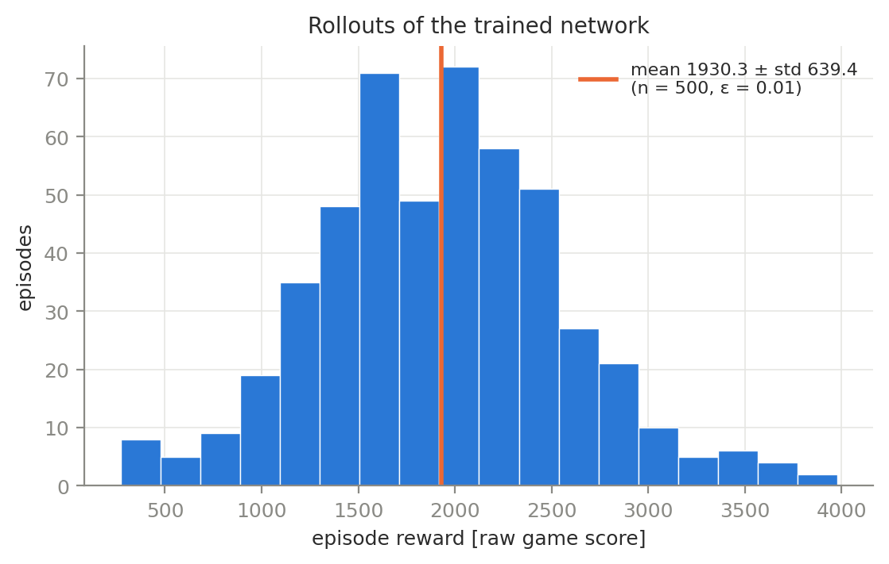

# IEMS 469 Assignment 2: Deep Q-Network

DQN with a replay buffer, a target network and Double DQN targets for CartPole-v1 (γ = 0.95) and
ALE/MsPacman-v5 (γ = 0.99). Full write-up: [report/report.pdf](report/report.pdf).

## Results

| | eval episodes | checkpoint | mean ± std reward |
|---|---|---|---|
| CartPole-v1 | 500 (ε = 0) | best.pt | 499.5 ± 6.8 |
| MsPacman-v5 | 500 (ε = 0.01) | last.pt | 1930.3 ± 639.4 |
| MsPacman-v5, random policy | 100 | | 260.1 |

<p>
 
 
</p>

All figures and `summary.json` (validation results) are in `results/`.

## Install

Python 3.10+.

```bash
pip install -r requirements.txt
pip install torch --index-url https://download.pytorch.org/whl/cu128   # RTX 50xx (Blackwell)
pip install torch --index-url https://download.pytorch.org/whl/cu126   # GTX 1080 (Pascal, sm_61)
```

## Train, evaluate, plot

```bash
python train.py --env cartpole --name cartpole_main --seed 2
python train.py --env pacman --name pacman_main --seed 0 --episodes 5000 --max_hours 20 --lr_final 5e-5
python train.py --env pacman --name pacman_main --resume        # continue after an interruption

python evaluate.py --run runs/cartpole_main --episodes 500
python evaluate.py --run runs/pacman_main --episodes 500 --ckpt last.pt --device cuda
python evaluate.py --run runs/pacman_main --random --episodes 100

python plots.py --run runs/cartpole_main
python plots.py --run runs/pacman_main
python extra_plots.py --all
```

Every hyperparameter is a flag (`python train.py --env pacman --help`). Each run writes `config.json`,
`train.csv`, `checks.csv`, `counters.json` and checkpoints to `runs/<name>/`; `evaluate.py` adds `eval.csv` and `eval.json`.

## Validation

Each script prints one result line, saves a figure or table to `results/` and records the result in `results/summary.json`.
Run evaluation first (T5 and T7 read the eval files). `--quick` runs a few-second pipeline check.

| test | what it checks | command |
|---|---|---|
| T1 | max Q approaches 1/(1−γ) for γ = 0.8, 0.9, 0.95 | `python validate/t1_gamma_sweep.py` |
| T2 | learned Q matches exact Q* on a 10-state chain; zero-reward control gives Q = 0 | `python validate/t2_chain_mdp.py` |
| T3 | bootstrapping through time-limit truncation (vs treating it as terminal) | `python validate/t3_truncation.py` |
| T4 | ablation: no target network, no replay buffer | `python validate/t4_ablation.py` |
| T5 | predicted Q vs realized discounted return on eval episodes | `python validate/t5_q_vs_return.py` |
| T6 | first 10 updates traced by hand (`results/trace_cartpole.md`); determinism | `python validate/t6_trace.py` |
| T7 | MsPacman frame-stack masking, life-loss terminals, reward clipping, random baseline | `python validate/t7_pacman_edges.py` |

## Layout

```
dqn/envs.py      CartPole and MsPacman envs; preprocessing, 4-frame stack, life-loss flag
dqn/nets.py      MLP (CartPole), CNN (MsPacman)
dqn/buffer.py    replay buffers; FrameBuffer stores each frame once and masks episode boundaries
dqn/agent.py     DQN: action selection, Double DQN target, Huber loss, target sync
dqn/schedule.py  piecewise-linear epsilon schedule
dqn/utils.py     seeding, logging, checkpoints, policy loading
train.py         training
evaluate.py      rollouts of a checkpoint or a random policy
plots.py         max Q, reward and eval-histogram figures
extra_plots.py   CartPole policy map, MsPacman visit heatmap
validate/        validation tests T1-T7
results/         figures, summary.json, trace_cartpole.md
report/          report.pdf
```
